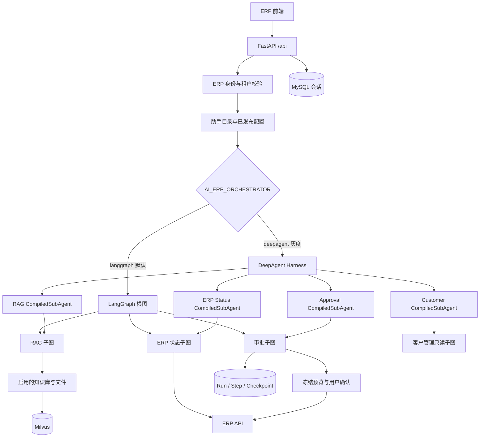

# AI ERP RAG Assistant

面向 ERP 场景的智能助手服务，将企业知识库 RAG、客户管理查询、ERP 实时查询、审批工作流和多轮会话统一在
一个 FastAPI 应用中。

项目的核心原则是：**LLM 负责理解、规划和语言生成；身份、权限、检索范围、字段校验、人工确认
和 ERP 写入由确定性代码控制。**

## 1. 技术栈

| 层级 | 主要技术 | 职责 |
|---|---|---|
| HTTP API | FastAPI、Pydantic | 接口契约、CORS、依赖注入和异常处理 |
| Agent 编排 | LangGraph | 状态管理、业务路由、子图和人工确认 |
| Agent Harness | DeepAgents | 按助手能力委派受限 `CompiledSubAgent` |
| LLM | LangChain OpenAI-compatible | 意图规划、字段提取、Rerank 和回答生成 |
| 向量检索 | Milvus | Chunk 向量、租户元数据、文档状态和来源引用 |
| 业务数据 | ERP HTTP API | 用户身份、审批模板、实时状态和业务提交 |
| 持久化 | MySQL、SQLAlchemy | 助手配置、会话、导入任务和 Durable Execution |
| 可观测性 | LangSmith、审计日志 | Graph/LLM Trace、耗时、异常和操作审计 |

## 2. 总体架构



两种编排模式共用相同的业务子图和工具，不维护两套业务规则：

- `langgraph`：默认模式，由根图完成意图规划、路由和子图调用。
- `deepagent`：父 Agent 负责理解和领域委派，子代理内部仍执行原有确定性 LangGraph 子图。

## 3. 项目目录

```text
ai_erp_rag_assistant/
├─ app/
│  ├─ main.py                 # FastAPI 入口、CORS、异常处理和 /health
│  ├─ config.py               # .env、模型、Milvus、ERP、MySQL 配置
│  ├─ database.py             # MySQL Session；不自动建表或执行迁移
│  ├─ assistant_catalog.py    # 服务端可信的助手类型规则
│  ├─ api/
│  │  ├─ router.py            # /api 路由统一注册
│  │  ├─ dependencies.py      # ERP 身份、租户隔离和运行配置
│  │  ├─ schemas.py           # 业务接口请求/响应模型
│  │  ├─ admin_schemas.py     # RAG 后台接口模型
│  │  └─ routes/              # Chat、RAG、审批、会话、后台管理等接口
│  ├─ graph/
│  │  ├─ state.py             # 根状态和各领域 State
│  │  ├─ workflow.py          # LangGraph 根图、路由和节点
│  │  ├─ subgraphs.py         # RAG、ERP 状态、审批三个确定性子图
│  │  └─ studio.py            # LangGraph Studio 图入口
│  ├─ agents/
│  │  ├─ compiled_subagents.py # 子图到 CompiledSubAgent 的适配
│  │  ├─ harness.py            # DeepAgent 能力白名单和安全边界
│  │  └─ workflow_adapter.py   # DeepAgent 与统一聊天接口适配
│  ├─ tools/
│  │  ├─ rag/                 # 基于 State 的知识检索工具
│  │  ├─ erp/                 # ERP 只读查询工具
│  │  ├─ customer/            # 客户管理动态只读查询工具
│  │  └─ approval/            # 审批表单、预览和提交工具
│  ├─ services/
│  │  ├─ model_service.py     # Planner、抽取、Rerank、回答和引用
│  │  ├─ embedding_service.py # Embedding 客户端和向量维度校验
│  │  ├─ milvus_service.py    # Collection、写入、检索和故障恢复
│  │  ├─ document_ingest_service.py # 文档解析和 Chunk 构造
│  │  ├─ rag_ingest_service.py      # 解析→切分→Embedding→Milvus
│  │  ├─ erp_client.py        # ERP API 和读写模式控制
│  │  ├─ session_repository.py      # 长期会话持久化
│  │  └─ execution_*          # Durable Run、Step、Checkpoint 和租约
│  └─ repositories/
│     └─ rag_admin.py         # 助手、Prompt、知识库和导入任务仓储
├─ data/knowledge/            # 本地原始知识文件与可审查中间结果
├─ docs/                      # 架构、接口、数据库和评估文档
├─ docs/database/             # 仅供人工审核执行的 SQL
├─ evals/                     # RAG/Agent 评估集及独立工作流评估执行器
├─ scripts/                   # 文档导入、RAG 和 Agent 评估脚本
├─ tests/                     # 单元与契约测试
├─ langgraph.json             # Studio 图注册
├─ .env.example               # 完整配置模板
└─ pyproject.toml             # Python 依赖和项目元数据
```

## 4. 核心运行链路

### 4.1 统一聊天入口

`POST /api/chat` 的主要流程：

1. 从 `Authorization` 和 `UID` Header 获取当前 ERP 登录态。
2. 调用 ERP 用户接口，得到可信的用户、公司、部门、角色和权限。
3. 根据 `assistant_key` 判断审批助手、客户管理助手或 RAG 助手。
4. RAG 助手加载当前公司的已发布 Prompt、模型参数和知识库范围。
5. 根据 `AI_ERP_ORCHESTRATOR` 进入 LangGraph 或 DeepAgent Harness。
6. 执行对应业务子图，生成回答、引用、动态表单或冻结预览。
7. 保存脱敏会话状态；流式请求通过 SSE 返回 `metadata/chunk/final/done`。

客户端传入的 `company_id`、权限标签和助手类型都不是可信身份来源，最终边界由 ERP 验证结果和
服务端配置决定。

### 4.2 RAG 导入和检索

```text
文件上传
  → 文档类型识别
  → 文本与页码解析
  → 语义切分
  → Embedding
  → 向量维度校验
  → 写入知识库对应的 Milvus Collection
  → 保存导入阶段、计数和失败原因
```

查询时按 `company_id`、知识库状态、文件状态和助手检索范围过滤，先进行向量召回，再按配置执行
Rerank。最终回答返回来源文件、页码、知识库和 Chunk 信息，方便前端展示引用。

助手支持两种检索范围：

- `company_enabled`：当前公司全部启用知识库中的启用文件。
- `selected`：只检索助手已发布配置选中的一个或多个知识库。

请求级知识库范围只能收窄，不能扩大已发布配置的权限边界。

### 4.3 ERP 审批和 Durable Execution

审批子图是确定性状态机：

```text
识别审批意图
  → 读取模板和字段
  → 逐项追问与服务端校验
  → 生成冻结预览
  → 等待用户明确确认
  → 使用稳定 Idempotency-Key 提交 ERP
```

启用 MySQL 会话后，每次 ERP Agent 请求可记录 `Run → Step → Checkpoint`。服务中断或租约过期后，
前端使用相同 `request_id` 重试即可恢复；Authorization、Cookie 和 API Key 不写入持久化状态。

## 5. 数据边界

| 数据 | 存储位置 | 说明 |
|---|---|---|
| 助手、Prompt、知识库配置 | MySQL | 使用已发布版本，不从请求体临时覆盖 |
| 原始文档和解析结果 | `data/knowledge/` | 便于审查、追溯和重建向量 |
| Chunk 和向量 | Milvus | 按公司、知识库、文件状态过滤 |
| ERP 实时数据 | ERP API | 不复制为知识库静态事实 |
| 会话和 Durable 状态 | MySQL 或内存 | 由 `AI_ERP_SESSION_STORE` 选择唯一状态源 |
| Trace 和审计 | LangSmith、JSONL | 敏感认证信息在上传或落盘前脱敏 |

项目不会在启动时自动建表、迁移或清空 Collection。`docs/database/` 中的 SQL 必须由人工审核后
在目标环境执行。

## 6. 启动方式

### 6.1 准备环境

需要 Python 3.14、`uv`、Docker Desktop。复制配置模板并填写实际环境参数：

```powershell
Copy-Item .env.example .env
uv sync --no-dev
```

配置优先级：系统环境变量 > 当前项目 `.env` > 仓库根目录 `.env`。

### 6.2 启动 Milvus

仓库中的 Milvus 使用独立 etcd，etcd 健康后才启动 Milvus；现有数据挂载在
`../docker/milvus-embed/volumes/milvus`。

```powershell
..\docker\milvus-embed\standalone_embed.bat start
..\docker\milvus-embed\standalone_embed.bat status
```

不要删除或清空 `volumes/milvus`。Milvus 默认监听 `127.0.0.1:19530`，健康检查位于
`http://127.0.0.1:9091/healthz`。

### 6.3 启动 API

```powershell
.\start_windows.ps1
```

默认地址：

- API：`http://127.0.0.1:8021`
- 健康检查：`GET /health`
- Swagger：`GET /docs`
- OpenAPI：`GET /openapi.json`

### 6.4 启动 LangGraph Studio

```powershell
uv sync --group dev
.\start_studio.ps1
```

Studio 注册三个图：

- `erp_rag_assistant`：原始 ERP/RAG 根工作流。
- `rag_deepagent`：只允许 RAG 子代理的 Harness。
- `approval_deepagent`：只允许 ERP 状态和审批子代理的 Harness。

## 7. API 模块

| 接口组 | 作用 |
|---|---|
| `/api/chat` | ERP/RAG 统一对话，支持 RAG、审批和客户管理助手，支持 JSON 和 SSE |
| `/api/assistants/*` | 前端助手目录 |
| `/api/rag/search`、`/api/rag/chat` | 直接检索与带引用问答 |
| `/api/rag/ingest/*` | 文本、PDF、通用文档同步导入及失败重试 |
| `/api/rag/documents/*` | 文档列表、启停和精确删除 |
| `/api/rag/admin/*` | 助手、Prompt、知识库、数据源和绑定管理 |
| `/api/approval/*` | 审批模板、动态表单和候选项 |
| `/api/sessions/*` | 长期会话列表、消息、重命名和逻辑删除 |
| `/api/executions/status` | Durable Execution 状态查询 |
| `/api/workbench/summary` | ERP 个人工作台只读聚合 |

## 8. 关键配置

| 配置项 | 说明 |
|---|---|
| `AI_ERP_ORCHESTRATOR` | `langgraph`（默认）或 `deepagent` |
| `AI_ERP_SESSION_STORE` | `memory` 或 `mysql` |
| `AI_ERP_CORS_ORIGINS` | 允许访问 API 的前端来源 |
| `RAG_ADMIN_PERMISSION_CHECK_ENABLED` | 是否校验 RAG 后台管理员标签；关闭后仍保留登录和租户校验 |
| `MILVUS_URI`、`MILVUS_COLLECTION` | Milvus 地址和兼容默认 Collection |
| `LLM_*` | Planner、Rerank 和回答模型配置 |
| `EMBEDDING_*` | Embedding 端点、模型、维度和重试 |
| `ERP_*` | ERP 地址、读写模式和接口路径 |
| `AI_ERP_MYSQL_*` | 配置、会话和 Durable Execution 数据库 |
| `LANGSMITH_*` | 可选 Trace 项目、端点和工作区 |

所有可用参数及默认值以 [.env.example](.env.example) 为准。

## 9. Agent Evals：检查业务效果和改动回归

Agent Evals 用固定业务对话和明确的验收标准检查助手是否按预期完成任务。修改
Prompt、切换模型、新增工具或调整工作流后，运行同一组案例，就能发现以前正确的
行为是否变差，并从报告中定位失败的轮次和指标。例如，请假审批应先补齐字段、生成
预览、等待确认后再提交；旧预览确认必须被拒绝，已完成步骤重放不能重复调用提交工具。

当前示例集包含 15 个场景、21 轮对话，覆盖以下检查：

- 路由和能力边界：制度问题进入 RAG，客户查询进入客户助手，越界请求被阻断。
- 工具调用：名称、顺序、次数和指定参数正确，公司和用户身份沿用服务端可信上下文。
- 回答质量：满足关键词和禁词要求，无依据时明确拒答，引用来源和页码对应检索证据。
- 审批流程：字段追问、预览、确认、取消、禁止写入和 Durable Execution 步骤重放正确。

| 评估方式 | 检查什么 | 外部服务 |
|---|---|---|
| Agent Evals 默认离线模式 | 预设模型输出下，真实 LangGraph 工作流是否出现回归 | 使用模拟模型和业务数据，禁止外部连接 |
| Agent Evals `--with-llm` | 真实模型的路由、字段提取、回答，以及后续工作流表现 | 调用配置的 LLM，ERP、数据库和 Milvus 仍使用保护桩或模拟数据 |
| 现有 RAG 评估 | 知识检索 Recall@K、Rerank 排序、拒答和引用落地 | 按 RAG 评估脚本及配置执行，见 [RAG_EVALUATION.md](docs/RAG_EVALUATION.md) |

在项目根目录执行：

```powershell
# 默认离线回归，不需要启动 API、数据库、ERP 或 Milvus
.\.venv\Scripts\python.exe scripts/evaluate_agent.py --json

# 真实模型评估：读取现有 LLM 配置，会产生模型调用费用
.\.venv\Scripts\python.exe scripts/evaluate_agent.py --with-llm --json
```

报告输出逐轮失败项、各指标通过数和比例；全部通过退出码为 `0`，存在失败为 `1`，
评估配置无效为 `2`，可用于本地回归或 CI 检查。业务案例维护在
`evals/agent_cases.example.jsonl`，更详细的字段说明见
[AGENT_EVALUATION.md](docs/AGENT_EVALUATION.md)。

离线全部通过仅说明这些案例中的工作流行为符合预期，不能代表真实模型准确率或真实
检索质量。示例数据应逐步补充为脱敏后的实际业务问题，并人工复核模型答案。当前
执行器覆盖 LangGraph 编排，DeepAgent 父代理委派、HTTP/SSE 和真实服务恢复需单独验证。

## 10. 详细文档

- [完整运行和部署说明](docs/README.md)
- [架构与安全边界](docs/ARCHITECTURE.md)
- [前端接口文档](docs/RAG_FRONTEND_API.md)
- [数据库设计与执行顺序](docs/database/README.md)
- [RAG 评估说明](docs/RAG_EVALUATION.md)
- [Agent Evals：工作流回归和模型评估](docs/AGENT_EVALUATION.md)
- [代码逻辑详解](docs/CODE_LOGIC.md)
